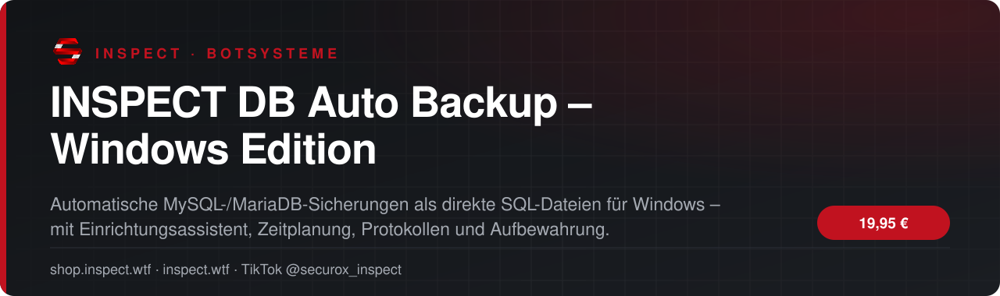
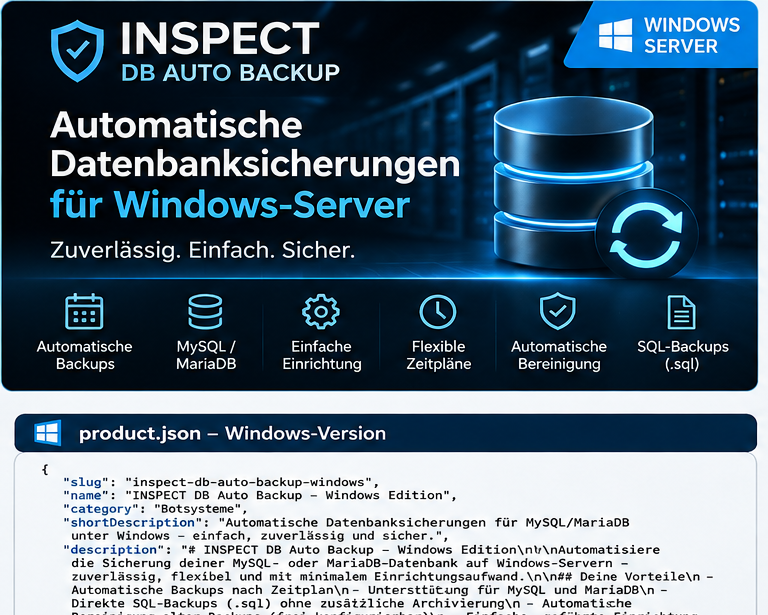

<!-- inspect-showcase: automatisch erzeugt, Änderungen bitte im Shop vornehmen -->

  
  
  
  

  
  
  

 

> 🇬🇧 **English:** INSPECT DB Auto Backup – Windows Edition – automatic MySQL/MariaDB database backups for Windows by SecuroX Inspect. Purchase and licensing exclusively at [shop.inspect.wtf](https://shop.inspect.wtf). Product details below are in German – questions are welcome on [Discord](https://discord.gg/inspect).

 

## Das Wichtigste auf einen Blick

<table>
  <tr>
    <td width="50%" valign="top">✔&nbsp; <b>Automatische Backups für MySQL und MariaDB</b></td>
    <td width="50%" valign="top">✔&nbsp; <b>Speicherung als normale, unkomprimierte .sql-Dateien</b></td>
  </tr>
  <tr>
    <td width="50%" valign="top">✔&nbsp; <b>Automatische Suche nach mysqldump / mariadb-dump</b></td>
    <td width="50%" valign="top">✔&nbsp; <b>Einrichtungsassistent mit vorgeschlagenen Standardwerten</b></td>
  </tr>
</table>

## Überblick

#### INSPECT DB Auto Backup – Windows Edition

## Automatische Datenbanksicherungen. Einfach eingerichtet.

Schütze wichtige Projektdaten mit planbaren Sicherungen für **MySQL- und MariaDB-Datenbanken**. INSPECT DB Auto Backup erstellt lokale, **unkomprimierte `.sql`-Dateien**, die sich direkt mit einem Texteditor oder passenden Datenbankwerkzeugen öffnen lassen. Geeignet für Gameserver, FiveM-Projekte und andere datenbankbasierte Anwendungen.

#### Deine Vorteile

- **Direkte SQL-Backups:** kein ZIP und kein GZIP für die eigentlichen Datenbanksicherungen.
- **Assistent zur Ersteinrichtung:** verständliche Eingaben und sinnvolle Standardwerte.
- **Automatische Werkzeugerkennung:** sucht `mysqldump` bzw. `mariadb-dump` in üblichen Installationspfaden; bei Sonderinstallationen kann eine Pfadangabe erforderlich sein.
- **Zeitgesteuerte Backups:** mit Windows-Aufgabenplanung, Standardzeiten 00:00 und 16:00 Uhr (anpassbar).
- **Sofort-Backup auf Abruf** und **Statusanzeige**.
- **Automatische Aufbewahrung:** veraltete SQL-Sicherungen nach einstellbarer Frist entfernen (Standard 30 Tage).
- **Protokollierung:** nachvollziehbare Erfolgs- und Fehlermeldungen.
- **Lokale Verarbeitung:** keine obligatorische externe Cloud- oder INSPECT-Verbindung.

#### Einrichtung in drei Schritten

1. Python 3.9+ und MySQL-/MariaDB-Clienttools bereitstellen. 2. `01_EINRICHTEN.bat` per Doppelklick starten und Zugangsdaten eingeben. 3. `02_BACKUP_JETZT.bat` testen und anschließend `03_AUTOMATIK_INSTALLIEREN.bat` zur Windows-Aufgabenplanung starten.

#### Lieferumfang

Ein Downloadpaket für **Windows** mit Skripten für Einrichtung, sofortiges Backup, automatische Zeitplanung, Statuskontrolle und Deaktivierung, dem Backup-Programm sowie einer deutschsprachigen Anleitung.

#### Systemvoraussetzungen und wichtige Hinweise

- **Python 3.9 oder neuer** und ein lokal verfügbares MySQL-/MariaDB-Dump-Programm erforderlich. Eine eigenständige EXE ohne Python ist nicht Bestandteil dieser Edition.
- Erreichbarer MySQL-/MariaDB-Server und ein Datenbankkonto mit geeigneten Exportrechten erforderlich. Datenbankname, Benutzer und Passwort werden bei der Einrichtung abgefragt.
- Berechtigung zur Einrichtung geplanter Aufgaben unter Windows erforderlich.
- Sicherungen werden standardmäßig **lokal auf dem jeweiligen Server** gespeichert. Für Ausfallsicherheit empfiehlt sich zusätzlich eine externe Kopie.
- **Keine integrierte Ein-Klick-Wiederherstellung**; der Import erfolgt über geeignete Datenbankwerkzeuge. Testimporte in eine separate Datenbank werden empfohlen.
- Die automatisierte Sicherung ersetzt keine eigene Überwachung oder Wiederherstellungsprüfung.

**Hinweis:** Die praktische Funktionsprüfung ist je nach Zielsystem gesondert vorzunehmen. Hosting, Datenbankserver und kostenpflichtige Drittsoftware sind nicht enthalten.

## Kompatibilität

| | |
|:--|:--|
| Plattform | FiveM (GTA V) |

## Alle weiteren Funktionen

- Planbare Sicherungen mit Windows-Aufgabenplanung
- Manuelles Sofort-Backup
- Statusanzeige und nachvollziehbare Backup-Protokolle
- Einstellbare Backup-Zeiten und Aufbewahrungsdauer
- Automatische Bereinigung älterer SQL-Backups
- Lokale Speicherung ohne Cloud-Zwang
- Deutsche Installations- und Bedienungsanleitung
- Python 3.9+ und Datenbank-Clienttools erforderlich
- Keine integrierte automatische Wiederherstellung

## Preis

**19,95 €** &nbsp;–&nbsp; einmaliger Kaufpreis · Download und Lizenz im Kundenkonto

Sichere Zahlung mit PayPal oder Kreditkarte · Rechnung als PDF · Support auf Deutsch

## So einfach geht's

1. **Im Shop kaufen** – sicher bezahlen mit PayPal oder Kreditkarte.
2. **Sofort loslegen** – Download und Lizenz stehen direkt nach Zahlungseingang in deinem Kundenkonto bereit, die Rechnung erhältst du als PDF.
3. **Einrichten** – bei Fragen hilft dir unser Support im Discord weiter.

## Warum INSPECT?

<table>
  <tr>
    <td width="50%" valign="top"><b>🇩🇪 Entwickelt in Deutschland</b> Konzeption, Entwicklung und Support aus einer Hand.</td>
    <td width="50%" valign="top"><b>💬 Persönlicher Support</b> Schnelle Hilfe auf Deutsch im INSPECT Discord.</td>
  </tr>
  <tr>
    <td width="50%" valign="top"><b>🔒 Sichere Zahlung</b> PayPal oder Kreditkarte, Rechnung automatisch als PDF.</td>
    <td width="50%" valign="top"><b>⚡ Sofort verfügbar</b> Download und Lizenz direkt nach der Zahlung im Kundenkonto.</td>
  </tr>
</table>

## Häufige Fragen

<b>Wie erhalte ich das Produkt?</b>

 

Nach bestätigter Zahlung stehen Download und Lizenz in deinem Kundenkonto bereit. Die Rechnung erhältst du als PDF.

<b>Bekomme ich Hilfe bei der Einrichtung?</b>

 

Ja – unser Support hilft dir im [INSPECT Discord](https://discord.gg/inspect) persönlich und auf Deutsch.

<b>Wo kaufe ich offiziell?</b>

 

Ausschließlich im INSPECT Shop unter [shop.inspect.wtf](https://shop.inspect.wtf). Angebote von Dritten stammen nicht von uns.

## Kontakt

| | |
|:--|:--|
| 🛒 Shop | [shop.inspect.wtf](https://shop.inspect.wtf) |
| 🌐 Website | [inspect.wtf](https://inspect.wtf) |
| 💬 Discord | [discord.gg/inspect](https://discord.gg/inspect) |
| 🎬 TikTok | [@securox_inspect](https://www.tiktok.com/@securox_inspect) |
| ✉️ E-Mail | [info@inspect.wtf](mailto:info@inspect.wtf) |

---

<b>SecuroX Inspect</b> · Offizielle Produktpräsentation · Dieses Repository enthält keinen Quellcode und keine Produktdateien. 
Kauf und Lizenzen ausschließlich über <a href="https://shop.inspect.wtf">shop.inspect.wtf</a> · Inhalte werden automatisch aus dem Shop aktualisiert.

